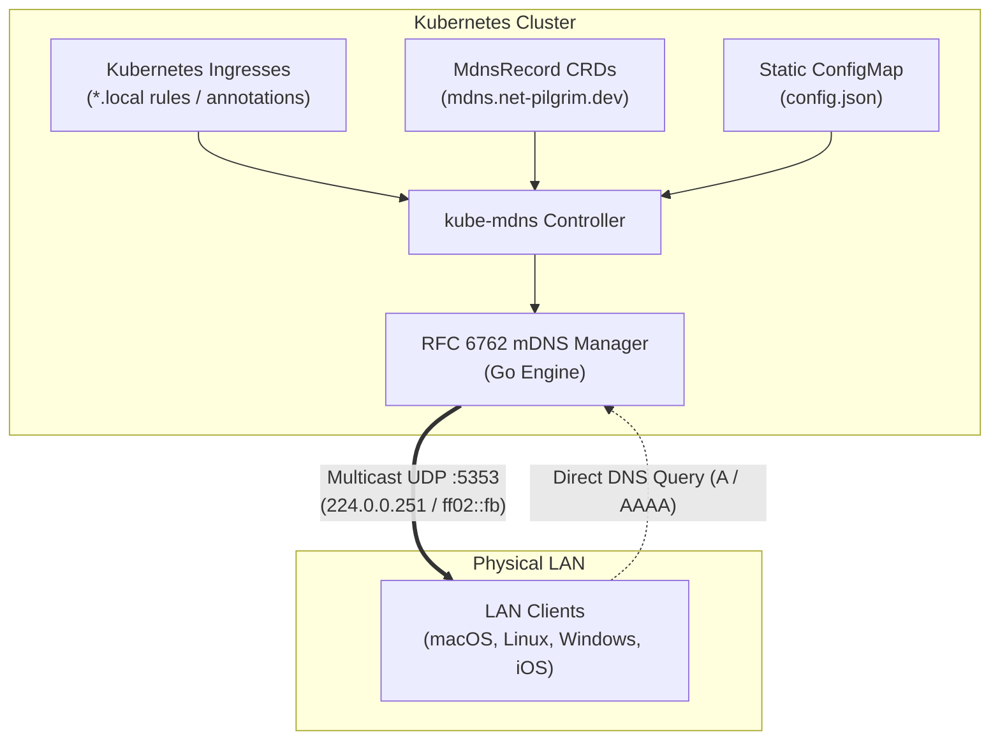

# kube-mdns

[](LICENSE.md)
[](https://github.com/net-pilgrim/kube-mdns/pkgs/container/kube-mdns)
[](charts/kube-mdns/README.md)

`kube-mdns` is a high-performance, lightweight Kubernetes controller and operator written in pure Go. It automatically discovers and advertises mDNS (Multicast DNS / Bonjour / Zeroconf) records across your physical Local Area Network (LAN) using standard multicast (`224.0.0.251:5353` / `[ff02::fb]:5353`).

With `kube-mdns`, any client on your local network (macOS, Linux, Windows, iOS, Android) can instantly resolve `.local` domains (e.g. `immich.local`, `jellyfin.local`, `paperless.local`) to your Kubernetes cluster without modifying local DNS servers, maintaining `/etc/hosts`, or managing split-horizon DNS.

---

## Key Features

- **Ingress Watcher Mode**: Automatically detects `.local` hostnames configured in standard Kubernetes `Ingress` resources.
- **Operator Mode & Custom Resource Definition (`MdnsRecord`)**: Publish arbitrary mDNS records declaratively using a native Kubernetes CRD, completely independent of Ingresses.
- **Granular Annotations & Labels**: Fine-tune hostnames, ports, DNS-SD service types, or provide explicit IPs (ideal for bare-metal / NodePort clusters without LoadBalancer status).
- **RFC 6762 Compliant Engine**:
  - Responds to `A`, `AAAA`, `PTR`, and `SRV` queries.
  - **Dual-Stack Fallback**: Modern clients (macOS, Windows, iOS) issue parallel `AAAA` queries; `kube-mdns` supplies `A` records in the Additional section per RFC 6762 §6.2 to eliminate client timeouts and negative caching.
  - **Unicast Support**: Honors the QU bit (0x8000) and ephemeral source ports to reply directly via unicast per RFC 6762 §5.4.
  - **Periodic Heartbeat**: Re-broadcasts active records every 30 seconds to perpetually populate client DNS caches (TTL = 120s).
- **Static Configuration**: Supports predefined manual hosts through a mounted JSON config.
- **Ultra Lightweight**: Single static Go binary, minimal memory footprint (~15MB RAM), multi-architecture container images (`linux/amd64`, `linux/arm64`).

---

## Architecture Overview



---

## Modes of Operation

`kube-mdns` supports four complementary ways to publish mDNS records:

### 1. Ingress Watcher Mode (Automatic)

By default, `kube-mdns` watches all `Ingress` resources in your cluster. If an Ingress rule contains a host ending in `.local`, it is automatically published:

```yaml
apiVersion: networking.k8s.io/v1
kind: Ingress
metadata:
  name: immich
  namespace: immich
spec:
  rules:
    - host: immich.local
      http:
        paths:
          - path: /
            pathType: Prefix
            backend:
              service:
                name: immich-server
                port:
                  number: 80
```

`kube-mdns` will resolve the IP from the Ingress's `status.loadBalancer.ingress[*].ip` (or the node host IP) and publish `immich.local` on the network.

---

### 2. Ingress Annotation & Label Filtering

You can customize mDNS publishing or publish services that do not use `.local` in their rule set by adding annotations:

| Annotation / Label | Type | Description | Example |
|---|---|---|---|
| `mdns.net-pilgrim.dev/enabled` | Annotation | Opt-in or opt-out (`"true"` / `"false"`) | `"true"` |
| `mdns.net-pilgrim.dev/hostname` | Annotation | Custom `.local` hostname to publish | `"photos.local"` |
| `mdns.net-pilgrim.dev/ip` | Annotation | Explicit IP address (comma-separated if multiple) | `"192.168.1.100"` |
| `mdns.net-pilgrim.dev/port` | Annotation | Override service port | `"8443"` |
| `mdns.net-pilgrim.dev/service-type` | Annotation | DNS-SD service type (default: `_http._tcp.local.`) | `"_https._tcp.local."` |
| `mdns.net-pilgrim.dev/publish` | Label | Bulk opt-in or opt-out | `mdns.net-pilgrim.dev/publish: "true"` |

#### Example: Bare-Metal Cluster with NodePort / Custom IP

In homelab or bare-metal setups (such as k3s or Talos) where Ingress resources may not have a cloud LoadBalancer IP populated, provide an explicit IP:

```yaml
apiVersion: networking.k8s.io/v1
kind: Ingress
metadata:
  name: navidrome
  namespace: navidrome
  annotations:
    mdns.net-pilgrim.dev/enabled: "true"
    mdns.net-pilgrim.dev/hostname: "music.local"
    mdns.net-pilgrim.dev/ip: "192.168.1.100"
    mdns.net-pilgrim.dev/port: "4533"
spec:
  rules:
    - host: music.home.internal
      http:
        paths:
          - path: /
            pathType: Prefix
            backend:
              service:
                name: navidrome
                port:
                  number: 4533
```

---

### 3. Operator Mode & CRD (`MdnsRecord`)

For services that do **not** use an Ingress resource (such as TCP/UDP streams, non-HTTP applications, headless services, bare-metal IoT nodes, Home Assistant integrations, or Samba/NFS shares), `kube-mdns` provides a native Kubernetes Custom Resource Definition: **`MdnsRecord`**.

#### Step 1: Install the CRD

```bash
kubectl apply -f https://raw.githubusercontent.com/net-pilgrim/kube-mdns/master/manifests/crds/mdnsrecords.yaml
```

*(Or locally: `kubectl apply -f manifests/crds/mdnsrecords.yaml`)*

#### Step 2: Create an `MdnsRecord` Resource

```yaml
apiVersion: mdns.net-pilgrim.dev/v1alpha1
kind: MdnsRecord
metadata:
  name: homeassistant
  namespace: homeassistant
spec:
  host: homeassistant.local
  ip: 192.168.1.100
  port: 8123
  serviceType: "_http._tcp.local."
  ttl: 120
```

#### Step 3: Inspect Created Records

`MdnsRecord` includes additional printer columns for quick inspection:

```bash
$ kubectl get mdns
NAME            HOST                  IP              PORT   SERVICETYPE          AGE
homeassistant   homeassistant.local   192.168.1.100   8123   _http._tcp.local.    42s
samba-share     nas.local             192.168.1.100   445    _smb._tcp.local.     10s
```

When an `MdnsRecord` is updated or deleted, `kube-mdns` immediately broadcasts RFC 6762 Goodbye packets (TTL=0) and cleans up its cache.

---

### 4. Static Configuration File (`config.json`)

You can also predefine static manual host entries via a JSON configuration file:

```json
[
  {
    "hostname": "router.local",
    "ip": "192.168.1.1",
    "port": 443,
    "service_type": "_https._tcp.local."
  },
  {
    "hostname": "printer.local",
    "ip": "192.168.1.50",
    "port": 9100,
    "service_type": "_printer._tcp.local."
  }
]
```

Mount this file into the pod and pass `--config /etc/kube-mdns/config.json`.

---

## Installation

### Option 1: Helm Chart via OCI (Recommended)

`kube-mdns` is published as an OCI artifact to GitHub Container Registry:

```bash
helm install kube-mdns oci://ghcr.io/net-pilgrim/charts/kube-mdns \
  --namespace kube-mdns-system \
  --create-namespace \
  --set kubeMdns.interface=eno1 \
  --set kubeMdns.enableCrd=true
```

To view all configurable Helm values, see the [Helm Chart Documentation](charts/kube-mdns/README.md).

---

### Option 2: Kubernetes Manifests

Apply the RBAC and deployment manifests directly:

```bash
# 1. Install CRD (optional, for operator mode)
kubectl apply -f manifests/crds/mdnsrecords.yaml

# 2. Deploy kube-mdns
kubectl apply -k manifests/base/
```

---

## Network & Host Requirements

> [!IMPORTANT]
> Because mDNS relies on Link-Local Multicast UDP (`224.0.0.251:5353` / `[ff02::fb]:5353`), the `kube-mdns` pod runs with:
> - `hostNetwork: true`
> - `dnsPolicy: ClusterFirstWithHostNet`
>
> This enables the container to bind directly to the physical network interface without being isolated behind Kubernetes overlay NAT (such as Flannel or Calico).

### 1. Host Firewall (`firewalld` / `ufw`)
Ensure inbound port `5353/udp` is permitted on your Kubernetes node:

- **Fedora / RHEL / CentOS (`firewalld`)**:
  ```bash
  sudo firewall-cmd --add-service=mdns --add-port=5353/udp --permanent
  sudo firewall-cmd --reload
  ```
- **Ubuntu / Debian (`ufw`)**:
  ```bash
  sudo ufw allow 5353/udp
  ```

### 2. Port 5353 Conflicts
If your host already runs a local mDNS daemon (such as `avahi-daemon` or `systemd-resolved` with mDNS enabled), stop or disable it so `kube-mdns` can exclusively bind to port 5353:

```bash
sudo systemctl disable --now avahi-daemon.service avahi-daemon.socket
```

---

## CLI Options

| Argument | Environment Variable | Default | Description |
|---|---|---|---|
| `--interface <iface>` | `INTERFACE` | `""` (all interfaces) | Physical network interface to bind (e.g. `eno1`, `eth0`) |
| `--port <port>` | `PORT` | `80` | Default service port fallback |
| `--service-type <type>` | `SERVICE_TYPE` | `_http._tcp.local.` | Default Bonjour/mDNS service type |
| `--config <path>` | `CONFIG` | `""` | Path to JSON file containing static host entries |
| `--debug` | `DEBUG` | `false` | Enable verbose debugging logs |

---

## License

This project is licensed under the [MIT License](LICENSE.md).
